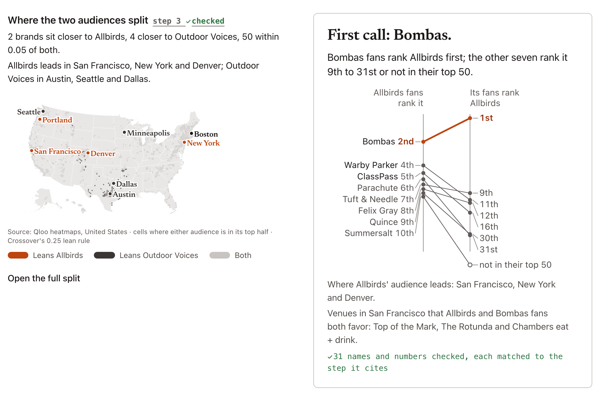
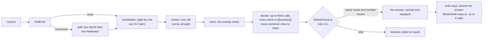
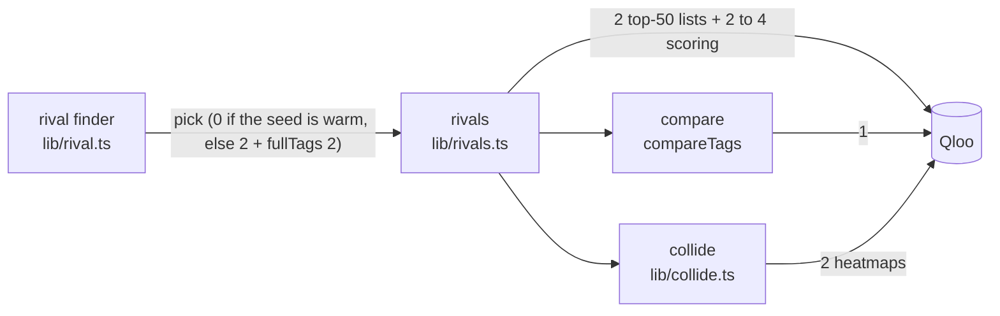
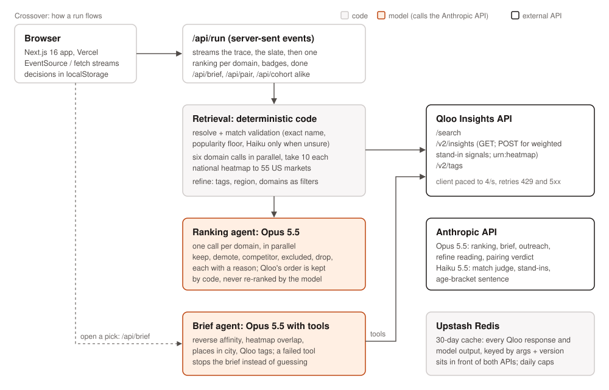

# Crossover

One name in. An agent measures in Qloo, step by step, and says who that brand, artist or show should call first. Every name and number in its answer is checked against the step it came from before the page shows it.

**Live:** https://crossover-henna.vercel.app (the Allbirds answer is on the front door; nothing to install). Built for the Qloo Agentic Hackathon, 2026. MIT.



## What it is

A partnerships team types a brand. Claude picks the next measurement and says why. It can only measure through six tools over the Qloo Insights API (`lib/ask/tools.ts`): confirm the name, find the closest same-field rival, split the two audiences on a US map, pick eight candidates by a fixed rule, score them under the seed's fans, and check whether two candidates reach the same audience. Then it names up to three calls. `lib/ask/check.ts` matches every name and number in that answer to the step it cites. An answer that fails isn't shown.

For Allbirds, all eight candidates tie within 0.05 on taste, so the page also reads the other direction (`lib/ask/both-ways.ts`): Bombas fans rank Allbirds first, and the other seven rank it 9th to 31st or leave it out of their top 50.

## Where Qloo is used

- `lib/qloo.ts` is the only file that calls Qloo. It paces calls to four a second, retries once on 429 and 5xx, trims responses, caches every response in Redis for 90 days and counts each call against a daily cap.
- `lib/ask/tools.ts` turns `/search` and `/v2/insights` into the agent's six tools. `lib/ask/agent.ts` is the loop.
- `lib/ask/both-ways.ts`, `lib/ask/smaller.ts` and `lib/ask/venues.ts` read beside the frozen answer.
- The full table of endpoints and parameters, file by file, is under "Every Qloo call" below.

## Run it

Nothing here needs a key. Node 22.18 or later.

```
npm ci
npm test            # 255 offline tests: 248 pass, 7 skip (they need Qloo data this repo doesn't hold)
npm run typecheck   # clean; runs next typegen first, which writes the page types a fresh clone lacks
npm run lint
npm run verify      # the checker and its attack, run on a made-up demo world
npm run build
```

To run the site itself you need a Qloo hackathon key, an Anthropic key and an Upstash Redis (`cp .env.example .env.local`, then `npm run dev`). A local run starts with an empty cache: the first ask of any name costs about 28 Qloo calls and 40 seconds and produces its own answer, not the frozen one on the live site. To see the product, use the live site.

## What we measured, and what it doesn't show

- We attacked the checker with 230 altered answers. It rejected 219. The 11 that got through, and the gap we found and fixed on the way, are on /audit#fool-it.
- We replayed 23 real collaborations with the real partner hidden among seven decoys. It landed in the top three 17 times. Two controls, committed to git before they ran, both failed: a random wrong seed brand also scored 17, and ranking the other way scored 5 against 3. So the candidate lists favor the real partner whoever asks, and the replay doesn't show that a seed's taste picks the right partner.
- Taste is one input for who to call first, never a verdict on a deal. Nothing here measures purchases or revenue.

## Qloo's data

Qloo's hackathon guide asks that no response data sit in a public repository, so this one holds none of the recorded asks or score tables. In their place: `lib/ask/demo/` (three made-up asks in the same shape, `scripts/demo-world.ts`), stand-ins for the six audit tables the pages read (marked `"demo": true`; /audit and /replay say so), and an invented search table (`fixtures/search.json`). Three files keep real sentences the live site prints, scores included: `lib/ask/blocked.json`, `audit/mutation.json` and `audit/judge-names.json`.

## Reading the code

Comments cite the date a rule changed ("rule v3.1, Oct 22") and the review round that asked for it. "ponytail:" marks a limit we know about and accepted on purpose. The rules live in `lib/` and are tested; the page components under `app/` are long because each page is one story.

## Every Qloo call

| Endpoint | Parameters | What it's for | File |
|---|---|---|---|
| `GET /search` | `query`, `types` (brand, artist, tv_show, movie, person), `take=5` | Candidates for a typed name | `lib/qloo.ts`, via `app/api/resolve/route.ts` |
| `GET /search` | `query`, `types=urn:entity:brand`, `take=5` | Checking stand-in brands for a brand Qloo doesn't know | `lib/proxy.ts` |
| `GET /v2/insights` | `filter.type`, `filter.results.entities`, `take=1` | One typed card for a share link, or a chosen id in the review desk | `lib/slate.ts` (`getCard`), `app/api/review/route.ts` |
| `GET /v2/insights` | `filter.type`, `signal.interests.entities` (the seed), `filter.results.entities` (every candidate of that type), `take` | The review desk's fixed-list score: one call per entity type | `lib/review.ts` (`scoreForward`) |
| `GET /v2/insights` | `filter.type` (the seed's type), `signal.interests.entities` (a candidate), `filter.results.entities` (the seed), `take=1` | Reverse affinity, only across types (same-type affinity is symmetric) | `lib/review.ts` (`scoreReverse`) |
| `GET /v2/insights` | `filter.type` (each of six domains), `signal.interests.entities`, `filter.exclude.entities`, `take=10`, `feature.explainability` | The slate | `lib/slate.ts` |
| `POST /v2/insights` | the same, with weighted stand-ins as `signal.interests.entities` and an optional brand-category `signal.interests.tags` | Slates for brands Qloo doesn't know | `lib/slate.ts`, `lib/qloo.ts` (`proxyBody`) |
| `GET/POST /v2/insights` | refine adds `filter.tags` with `operator.filter.tags=union`, `filter.exclude.tags`, `filter.popularity.min`, `signal.location.query` (POST place calls use `filter.location.query`), or `signal.interests.tags` as a soft fallback | Constraints from the Refine box | `lib/refine.ts`, `lib/slate.ts` |
| `GET/POST /v2/insights` | `filter.type=urn:heatmap`, `signal.interests.entities`, `filter.location.query=United States` | The national heatmap, aggregated to 55 markets | `lib/qloo.ts`, `lib/cities.ts` |
| `GET /v2/insights` | `filter.type`, `signal.interests.entities` (the partner), `take=50` | Where the seed lands among the partner's fans (the rank chips, the brief's reverse rank, pairing, the review desk's evidence from cache) | `lib/fit.ts` |
| `GET /v2/insights` | the same plus `filter.results.entities` (the seed), `take=1` | The raw affinity when the seed is outside that top 50 | `lib/fit.ts` |
| `GET/POST /v2/insights` | `filter.type=urn:entity:place`, `filter.location.query` (a market), `filter.tags` (restaurant, bar, live music venue, or cafe and coffee shop under a no-alcohol constraint), both entities as signals, `take=8` | Venues both audiences favor | `lib/agent/brief.ts` |
| `GET/POST /v2/insights` | `signal.demographics.age` (each of six brackets), `filter.results.entities` (the partner), `take=1` | "Who does this land with?" | `lib/cohort.ts` |
| `GET /v2/insights` | `bias.trends=off` and `very_high`, `take=10` | Trends comparison, off by default: on the hackathon API it changed nothing | `lib/trends.ts` |
| `GET /v2/tags` | `filter.query`, `filter.parents.types` | Turning refine phrases into tag ids | `lib/refine.ts`, `lib/qloo.ts` |
| `GET /v2/tags` | `filter.query`, `filter.parents.types=urn:entity:brand` or `urn:entity:place` | A stand-in run's brand category; venue category tags | `lib/proxy.ts`, `lib/agent/brief.ts` |
| `GET /v2/tags` | `filter.query` | The brief agent's tag lookup tool | `lib/agent/brief.ts` |
| `GET /v2/insights` | `filter.type=urn:entity:brand`, `signal.interests.entities` (each seed), `take=50` | Each side's top 50 for a rivals pair; the finder's candidate list | `lib/rivals.ts`, `lib/rival.ts` |
| `GET /v2/insights` | `filter.type=urn:entity:brand`, `signal.interests.entities` (each seed), `filter.results.entities` (up to 50 of the union), `take` | Scoring the union under both seeds | `lib/rivals.ts` (`getRivals`) |
| `GET /v2/insights` | the rivals calls above with `filter.type` set to artist, tv_show, movie, podcast | "Beyond brands": the split in four more domains, read from the cache only | `lib/rivals.ts` (`XRAY_TYPES`) |
| `GET /v2/insights` | the review desk calls above, plus each contender scoring the others (`filter.results.entities`) | The /ask agent's tools; the overlap check | `lib/ask/tools.ts`, `lib/review.ts` (`scorePairs`) |
| `GET /v2/insights` | `filter.type` (the seed's type), `signal.interests.entities` (each of the eight), `take=50` | Both ways: the seed's rank among each candidate's fans, up to 8 calls on a cold ask | `lib/ask/both-ways.ts` |
| `GET /v2/insights` | `filter.type=urn:entity:brand`, `signal.interests.entities` (the seed), `take=20`, then the same with `filter.popularity.max=0.5` | Smaller names within 0.05 of the strongest brand for the seed's fans, 2 calls on a cold ask | `lib/ask/smaller.ts` |
| `GET /v2/insights` | `filter.type=urn:entity:place`, `filter.location.query` (the lead market), `filter.tags` (restaurant, bar, live music), seed and first call as signals, `take=8` | The ask's "where to start" venues | `lib/ask/venues.ts`, `lib/ask/where.ts` |
| `GET /v2/insights/compare` | `a.signal.interests.entities`, `b.signal.interests.entities` | Shared category tags for "Share by category" | `lib/qloo.ts` (`compareTags`) |
| `GET /v2/insights` | `filter.type=urn:heatmap`, `signal.interests.entities`, `filter.location.query=United States` | The two heatmaps behind the collision map (same key as the single map) | `lib/rivals.ts`, `lib/collide.ts` |
| `GET /v2/insights` | the seed's card and top-50 params, tags kept untrimmed | Genre, product category and competitor tags for the rival finder | `lib/qloo.ts` (`fullTags`), `lib/rival.ts` |
| `GET /v2/insights` | `filter.type=urn:entity:brand`, `signal.interests.entities` (each brand of a category but the last), `filter.results.entities` (the others), `take` | The category maps: every pair's mutual affinity, laid out by classical MDS in code | `lib/constellation.ts` |

`lib/qloo.ts` is the only file that talks to Qloo. It paces calls to four a second, retries once on 429 and 5xx, trims responses and counts every call against the daily cap. What the API returned when we probed it, and what we shipped because of it, is in `docs/qloo-field-guide.md`.


## One ask, request to result

`POST /api/ask` with `{"query":"Allbirds"}` streams server-sent events. Claude Opus 5.5 picks each tool and writes why first; the tools are code in `lib/ask/tools.ts`, and every Qloo call goes through `lib/qloo.ts`. For Allbirds: `/search` resolves the name; `/v2/insights` with `signal.interests.entities` reads its fans' top 50 brands and the rival finder picks Outdoor Voices; two top-50 lists, scoring the union under both seeds and two national heatmaps make the split; eight candidates come from the split by rule; one `/v2/insights` call with `filter.results.entities` scores all eight for Allbirds' fans (they tie within 0.05); each contender scores the others for the overlap check. The model then names three calls, and `lib/ask/check.ts` matches all 31 names and numbers in its answer to the steps they cite; an answer that fails isn't shown. Beside the frozen answer, code reads each candidate's fans' top 50 (`lib/ask/both-ways.ts`, up to 8 calls) for the both-ways line. "Its fans rank Allbirds Nth" is one `GET /v2/insights` per candidate, with `filter.type=urn:entity:brand` (the seed's type), `signal.interests.entities` set to that candidate's Qloo id and `take=50`: N is Allbirds' position in the list that comes back, and when Allbirds isn't in those 50 the cell reads "not in their top 50". A new name costs about 28 Qloo calls and 40 seconds; every response and the whole run are cached in Redis, so a repeat costs none.



Check the live site against this repo without a browser:

```
# the MCP server (Streamable HTTP): initialize
curl -s -X POST https://crossover-henna.vercel.app/api/mcp -H 'content-type: application/json' -H 'accept: application/json, text/event-stream' \
  -d '{"jsonrpc":"2.0","id":1,"method":"initialize","params":{"protocolVersion":"2025-06-18","capabilities":{},"clientInfo":{"name":"curl","version":"1"}}}'

# the deployed commit, today's Qloo calls and the month's remaining quota as Qloo reports it
curl -s https://crossover-henna.vercel.app/api/usage

# a cached ask, replayed: every step, the checked decision, and {"type":"done","cached":true} (0 Qloo calls)
curl -sN -X POST https://crossover-henna.vercel.app/api/ask -H 'content-type: application/json' -d '{"id":"78A44C09-E691-42DA-A553-5CDE6EE9B18A","type":"urn:entity:brand"}'
```

## Verify it with no keys

`npm run verify` (`scripts/verify.ts`) needs no API key, no Redis and no network (Node 22.18 or later for type stripping; measured on 23.11). The recorded asks are Qloo data, so this repo doesn't carry them (see Qloo's data, below). Verify runs on the demo world in `lib/ask/demo/`, three made-up asks in the recorded asks' shape, and prints:

- the frozen hash of each recorded ask from `docs/freeze.md`: Allbirds (1db30036) and Mt. Joy (79a549bd) are the cached answers production replays, byte for byte. The asks themselves stay private, so the hashes are checked where they are: by verify in the private repo the site deploys from, and against the cache by `scripts/ask-hashes.ts`, which also covers the Coca-Cola x Converse replay ask;
- the checker's verdict on each demo decision under rule v3.1, with the count of names and numbers it matched to a cited step: 31, 33 and 27, the same counts as the recorded Allbirds, Mt. Joy and Liquid Death answers;
- the nine tampers of the checker attack (`lib/ask/tamper.ts`), run over the three demo answers: 20 of 21 gated copies rejected, as on the recorded ones; the one miss, on the artist ask (Mt. Joy in the recorded set), is a score nudged by 0.03, the kind behind 8 of the 11 published misses; the "unbracketed invented brand" kind is the documented ceiling and is counted apart (0 of 3);
- the replay controls recounted from `audit/replay-control.json` and `audit/replay-reverse.json` where those are the real tables (the private repo): the real partner in the top three 17 of 23 times, 17 of 23 with the seed scrambled, and 5 against 3 when ranked the other way. Here they are stand-ins, so this step says so and skips.

It exits 1 if any of these differs. The full attack over every cached answer reads the Redis cache: `node --env-file=.env.local scripts/mutation-gate.ts` (0 Qloo calls); its published run, 219 of 230 under rule v3.1, is `audit/mutation.json`.

## Rebuild the real data

The real tables need a Qloo key and spend quota. Each script prints its Qloo calls and stops at `QLOO_DAILY_CAP`.

- The search recordings: `scripts/record-fixtures.ts` (20 calls), then `scripts/demo-search.ts` for the committed table.
- The held-out audit: `scripts/audit-run.ts <baseUrl> <outDir>` against a deploy writes `audit/results.json` (raw responses go to `<outDir>`, outside the repo).
- The replays: `scripts/replay-build.ts`, then `scripts/replay-score.ts` (one call per case), each run only after its protocol is committed. Then the controls: `scripts/replay-control.ts` (23 calls) and `scripts/replay-reverse.ts` (one call per distinct candidate, 106 at most). `scripts/popularity-fair.ts` (0 calls) runs last.
- The three recorded asks were captured from the production cache, from answers the site had already given. `scripts/demo-world.ts` makes the demo world from them, and `scripts/demo-audit.ts` makes the audit stand-ins from the real tables.

## How the checker works

The agent writes every brand, artist or show in double brackets and ends every sentence with the step numbers it rests on. The checker walks the outputs of the cited steps and collects every value under a `name` key and every numeric leaf. Each bracketed name, each plain-text name any step returned, and each number in the sentence must be in a cited step; decimals compare at two places, integers exactly. A score or rank right after a brand, in the same clause, must be that brand's own numbers, and a contrast word ("against", "while", "the others") ends the clause. Answers are re-checked under the current rule every time they're shown, so the cached runs and their hashes never change; `scripts/check-v2-gates.ts` re-runs the rule over every cached ask at 0 calls. The ceiling is documented: a plain-text name no step ever returned can't be caught, which is why the prompt brackets every name and the "Try to fool the checker" box re-brackets any capitalised name a visitor types. The gap we published: until rule v3.1 a rank that ended a sentence ("ranks 9.") wasn't bound to its brand; the tamper that found it stayed in the gate, and v3.1 rejects 219 of 230, with every miss on /audit#fool-it.

## The ask, in five minutes

- **The tie, and what separates it.** Each prepared ask's candidates (eight for Allbirds and Mt. Joy, six for Calm) tie within 0.05 by taste, because they come from the top 50 of the seed's own list; the page says so. At the top of the decision column, above "Call first", code beside the frozen answer draws the other direction: each candidate's fans' rank of the seed (`lib/ask/both-ways.ts`). Bombas fans rank Allbirds 1st; the other seven rank it 9th to 31st or not in their top 50. Shown only when the agent's three separate on it (Allbirds and Mt. Joy do, the Converse replay doesn't), never reordered.
- **The seller's side** (`lib/ask/pitch.ts`, `/ask/<id>/pitch`). The same both-ways rows read down the right column: the name whose fans rank the seed highest is the pitch, and the pitch line is a template over the two ranks and the review score. The line is checked by `lib/ask/check.ts` with the both-ways rows appended as one cited step, so a wrong number is rejected the same way (`lib/ask/pitch.test.ts`). Mt. Joy: Allbirds fans rank it 4th; Outdoor Voices fans rank it 26th. It is what a seller can say, not a forecast: ranked this way the replay found the real partner 5 times in 23.
- **We attacked the checker.** `scripts/mutation-gate.ts` copies every cached answer, changes one fact per copy (9 kinds) and re-checks it: rule v2 rejected 207 of 228, the misses showed two holes, rule v3 rejected 217 of 228; a later gap (a rank that ends a sentence wasn't bound to its brand) was found, fixed in rule v3.1 and added to the gate's rank tamper, and v3.1 rejects 219 of 230, with the gap and every miss published on /audit#fool-it. Any answer has a "Try to fool the checker" box running the same code in the browser (`lib/ask/fool.ts`).
- **Smaller names, nearly the same fit** (`lib/ask/smaller.ts`). Under the answer, Qloo's brand list for the seed's fans read again with `filter.popularity.max=0.5`: the brands that stay within 0.05 of the leader (the answer's own tie rule). Allbirds: The Recreationalist at popularity 0.50 scores 0.90 against Outdoor Voices' 0.94 at 0.96. Gate run first (its file is Qloo data, kept private): the same entity carries the same affinity in both reads, so the comparison holds; popularity 0 is Qloo's "no measurement" and is left out.
- **Use it from your agent (MCP).** `https://crossover-henna.vercel.app/api/mcp` (Streamable HTTP, `app/api/mcp/route.ts`): `crossover_ask` returns a cached checked answer with every cited step, `crossover_check` runs the checker on any decision and steps. Read-only over the cache, so it never spends Qloo calls. The URL opened in a browser describes the server and how to connect; `node scripts/mcp-gate.ts <url>` is the round-trip test.
- **Agent or pipeline.** The order of tools is set in the prompt; the branches follow what Qloo returned. `scripts/routes.ts` counts them from the cache (Oct 15: 39 asks, 5 routes, 3 stopped at the name). Each step on the page says where it forked.
- **Six names a judge might type** (`scripts/judge-names.ts`, results in `audit/judge-names.json` and on /audit): run on the live site before judging; the gate failed and is published.
- **Probes that failed stay on /audit**: where a candidate leads, the collision diff candidate against seed, an audience segment, an age bracket.
- **Field notes** (`lib/ask/field-notes.ts`): the same `fields()` the candidates cut uses names the field it cut ("Own field left out: Baseball"), or says it had nothing to cut with (Chipotle).

The nav is four stops: the ask (/), two names in (/vs, where audiences split, cell by cell on a US map), real deals (/replay, 23 real collaborations hidden among decoys), and a public audit (/audit) of how well the rules held up, including two frozen replays of real collaborations. Pick three (/pick-three) is in every page's footer and one click from any answer. Whole-aisle maps (/map/<category>) sit in /vs's footer; /find, /pair, /triage, /s, /review and /end-card still resolve but nothing in the nav or a footer links them.


## The honesty layer

- **Match validation** (`lib/resolve.ts`). Qloo's search returns confident wrong matches for names it doesn't know (Fruition Chocolate Works comes back as Bath & Body Works). A match is confident only on an exact name or alias above a popularity floor of 0.3 (the review desk adds a cross-type check; see above). Several exact hits keep Qloo's relevance order, and an artist beats a person with the same name. Token overlap becomes a picker, and Claude Haiku is asked only in the narrow band in between. The user always sees the card and can say "Not it". The resolver is tested against recorded search results for 22 names, 14 of them small brands Qloo doesn't know.
- **Stand-ins.** For a brand Qloo doesn't know, the user describes it and names brands their customers love. Haiku suggests more, and each is checked in Qloo. The slate is built from weighted stand-ins (10, 7, 5), and a banner says so on every screen.
- **Never rank by popularity.** Order is Qloo's affinity order, kept by code. The model reviews picks but cannot reorder them. Popularity is a floor for matching and, on the front door, a labelled reference column, never a correction.
- **Qloo's data.** Qloo's hackathon guide asks that no Qloo response data sit in a public repository, so this repo holds none: no recorded responses and no tables of Qloo scores. The recorded asks, the audit tables and the search recordings stay in the private repo the live site deploys from. In their place are `lib/ask/demo/` (three made-up asks, `scripts/demo-world.ts`), stand-ins for the six audit tables the pages read (`scripts/demo-audit.ts`, marked `"demo": true`, and /audit and /replay say so), and an invented search table (`scripts/demo-search.ts`). Their names are invented, so any match to a real company is chance. Entity ids and brand names stay in the code so it can call the API, and three files keep sentences with scores that the live site also prints (named under "Qloo's data" above). No third-party logos or images in the app.
- **Say what didn't work.** Refine phrases that map to nothing are listed as "Couldn't apply". Kinds of partner without a Qloo tag ("no cookware") are applied by the ranker and labeled "Applied by the agent". A fit ranked in only one side's top 50 shows as such instead of being hidden.

---

<details>
<summary><strong>More: the walkthrough, rivals, the review desk, the audit, architecture, the agent design, the full test list</strong></summary>

## Running the site

**Fixtures.** `fixtures/search.json` is an invented search table for the resolver tests: our queries, with every word of Qloo's results that isn't the query's own replaced, so the resolver's token rules hold. `node --env-file=.env.local scripts/record-fixtures.ts` records the real results into `fixtures/demo/search.json`, and `scripts/demo-search.ts` writes the table from it. `fixtures/demo/` (gitignored, since it is Qloo data) also holds the four example slates so local UI work spends no quota (`scripts/record-demo.ts`). In development, a file cache in `.cache/` sits in front of Redis.

**Warming.** `node --env-file=.env.local scripts/warm.ts <url> scripts/warm-list.json [--no-cohort]` runs resolve, the full slate, badges and the top brand's brief for each name, one at a time. It stops before the daily cap, logs Qloo calls per name, skips names that don't resolve confidently (or uses a hand-picked id recorded with a note), and records progress so it can resume.

**Why a daily cap.** The hackathon key has a monthly quota, and one cold ask costs about 28 (9 to 22 for the steps, up to 8 for the both-ways table). The cap is counted in Redis across every serverless instance, so a burst of new names or a crawler can't spend the month. Each visitor also gets 20 new briefs a day; anything already generated is free. When either limit or the Anthropic balance runs out, the app says so plainly and points to the example brands.


## The 30-second path

1. Open https://crossover-henna.vercel.app. Allbirds is asked: the split map against Outdoor Voices, "First call: Bombas" with the both-ways line and slopegraph, the both-ways table at the top of the decision column, and the steps with their why lines.
2. Click **An artist: Mt. Joy**: no same-field rival, so the agent takes the fans' top 50 and the picture becomes fame against taste.
3. Open **Call sheet** under any answer for the one-page version.
4. Open **/audit** for the replays of 23 real collaborations and the two controls that failed, the checker's blocked list, the six judge names and the probes that failed.
5. **Two names in** (/vs) splits any two names on a US map; **Pick three** asks you to choose before it reveals.

## Rivals (/vs and the front door)

Two names, one question: where do their audiences part ways? The front door's two inputs run a pair; leave the right one blank and the finder picks a rival. Pairs are cached by order, so A vs B and B vs A are separate keys; links the app builds (the category maps' "Open X vs Y") always use one fixed order so any click lands on the same cached pair.



A fully cold pair is 8 or 9 calls; a warm one is 0.

- **Rivals** (`lib/rivals.ts`, `GET /api/rivals?a=&ta=&b=&tb=`, label `rivals-v1`). Each side's top 50 brands, the union minus the two seeds, scored under both seeds with `filter.results.entities` in chunks of 50 (Qloo's `take` ceiling). A brand leans to a side at a gap of 0.05 or more, the review desk's tie width; everything else is shared. Brands sharing a second-level genre tag with either seed fold into a same-field group. A fully cold pair is 8 calls, run serially; each visitor gets ten cold pairs a day.
- **Compare** (`compareTags` in `lib/qloo.ts`). `/v2/insights/compare` returns tags only on this host, so it supplies the "Share by category" line and nothing else.
- **Collide** (`lib/collide.ts`). Both national heatmaps on Qloo's shared grid, each re-ranked to percentiles within the cells both carry, then diffed. A cell leans at a gap of 0.25; cells outside both sides' top half aren't drawn. Person seeds have flat heatmaps and get no map.
- **Rival finder** (`lib/rival.ts`, `GET /api/rival?a=&ta=`). The closest brand in the seed's top 50 that shares its second-level genre tag, then its Qloo product category, then three chips from the broader genre. Qloo's `competitor_brand` tags ride along as a second chip row, searched only when clicked. Artists and people get brand chips, never an automatic pair. It reads untrimmed tags (`fullTags`), 2 extra cached calls per seed.

## The review desk

`lib/review.ts` holds the rules (label `review-v3`), `app/api/review/route.ts` serves them, and the page only renders.

- **Identity first.** Only an exact name confirms on its own; an exact name that a known entity of another type also carries asks which one. LLM suggestions never confirm. Ambiguous names get a one-click picker, and share links carry the chosen id.
- **One call scores the list.** `filter.results.entities` with every candidate's id scores a fixed list against the seed's audience, one call per entity type. Types are never ranked against each other.
- **Leader-relative ties.** A group is the strongest measured name plus everything within 0.05 of it; no order is claimed inside a group. A top group of four or more is "no clear three".
- **Missing is never zero.** Qloo's fallback constants, three or more bit-identical values in one call, and a pair repeating across unrelated signals all read "no measurement".
- **Buyer gates.** Named exclusions and whole-word tag exclusions are hard gates; the reason quotes Qloo's tag.
- **Rank facts, not direction words.** Same-type affinity in Qloo is symmetric, so the product reports where each side ranks among the other's fans, never that one side likes the other more.

## The audit

`audit/briefs.json` is the protocol (audit-v1): twelve brand briefs of eight candidates, split six dev and six held-out by a fixed seed, plus 24 resolution challenges. It was frozen in git (commit `57cbc48`) before the held-out briefs ran once through `scripts/audit-run.ts`. Its results are Qloo scores, so `audit/results.json` stays private (here it is a stand-in) and /audit on the live site shows them: 4 of 6 held-out briefs give a clear three; 0 of 12 "famous" names reach the picks; resolution was 20 of 24 as run and 24 of 24 after the review-v3 fix, labelled as not held-out.

## Architecture

The front door's agent is `lib/ask/agent.ts` with its tools in `lib/ask/tools.ts`, streamed by `app/api/ask/route.ts` and cached per name and prompt version. The diagram below is the older slate path (/find), which still runs behind /vs.

### The older slate path (/find, still behind /vs)



A run is one server-sent event stream. Code resolves the name, fetches six domains and the national heatmap from Qloo in parallel, and sends the slate as soon as it lands (about 6 s cold). The ranking agent then reviews each domain in parallel and streams its verdicts (about 18 s cold). Opening a pick starts a second stream: the brief agent, which calls Qloo through four tools. Every Qloo response and every model output is cached in Redis for 90 days under its arguments plus a prompt version, so a warm run returns in under a second and costs nothing.

## The agent design

Retrieval is code because Qloo's numbers are the evidence, and code makes the same calls the same way every time. Reasoning is the model's because judging fit, competitors, constraint breaks and a launch plan from those numbers is what a strategist does. The ranking agent may keep, demote, label a competitor, exclude by constraint or drop a pick, and every decision except keep needs a stated reason. It may not reorder picks, invent them or cite numbers it wasn't given. The brief agent may call four Qloo tools and stops if one fails rather than writing without evidence; outreach is drafted only after a person approves.

## Test list

`npm test` runs 255 offline tests:

- match validation against the invented search table
- the review rules: missing data, leader-relative ties, selection, buyer gates, identity, request hygiene and share links
- ranking order and decisions
- refine constraint sets, including agent-applied categories and region handling
- market aggregation and the overlap between two audiences
- fit badges and pairing classes
- brief text parsing and the evidence-to-log mapping
- cohort brackets, trends classification and share-link checks
- failure classification
- rivals leans and same-field folds, the collision map, the rival finder and the vs payload
- the category maps: the affinity matrix, missing and unknown brands, and the layout on a fixed fixture
- share-link and category-map path checks (malformed links get a real 404)
- the pitch sheet: the seller's pick, its line through the checker, and four tampers rejected
- the checker attack's tampers over the three demo asks (20 of 21 gated copies rejected, as on the recorded ones) and, where the recorded asks are present, the Allbirds ask's frozen hash
- the demo-data notice, shown only where the audit tables are stand-ins
- a guard that no client component imports the server-only Qloo client

`npm run typecheck` is clean (it runs `next typegen` first, which writes the page types a fresh clone lacks).

</details>

## License

MIT, see [LICENSE](LICENSE). US state shapes: `data/us-states-10m.json` from [us-atlas](https://github.com/topojson/us-atlas) 3.0.1 (ISC).
